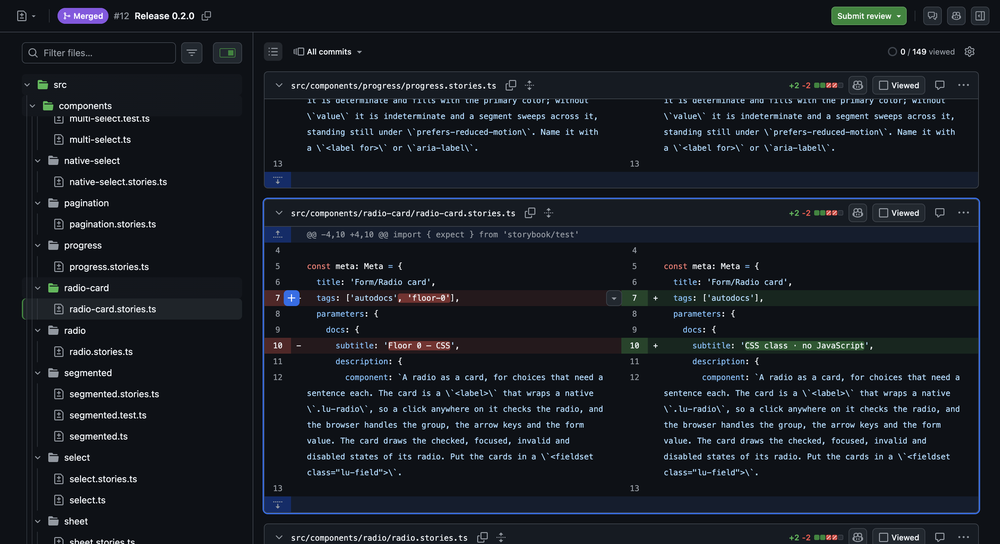
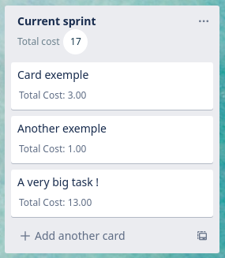

# Userscripts

A collection of small userscripts I use day to day to fix or extend the websites I work with: GitHub, ChooseMyCompany, Lucca, Trello and a few others.

## Table of contents

- [Requirements](#requirements)
- [Installation](#installation)
- [Scripts](#scripts)
  - [GitHub](#github)
  - [ChooseMyCompany](#choosemycompany)
  - [Lucca](#lucca)
  - [Other websites](#other-websites)
- [Screenshots](#screenshots)
- [Development](#development)
- [License](#license)

## Requirements

You need a browser or an extension that runs userscripts:

| Browser | Extension |
| --- | --- |
| Chrome, Edge, Brave | [Tampermonkey](https://chrome.google.com/webstore/detail/tampermonkey/dhdgffkkebhmkfjojejmpbldmpobfkfo) |
| Firefox | [Tampermonkey](https://addons.mozilla.org/firefox/addon/tampermonkey/) or [Greasemonkey](https://addons.mozilla.org/firefox/addon/greasemonkey/) |
| Safari | [Userscripts](https://github.com/quoid/userscripts) |
| [qutebrowser](https://qutebrowser.org) | Built in: drop the file in `~/.local/share/qutebrowser/greasemonkey/` |

## Installation

Click the **Install** link of a script below. Your extension opens the raw file and offers to install it.

Every script declares an `@updateURL` pointing to this repository, so your extension picks up new versions on its own.

## Scripts

### GitHub

| Script | Description | |
| --- | --- | --- |
| **Code background dark orange** | Gives `<code>` and `<tt>` tags in `.markdown-body` a dark orange background so inline code stands out. | [Install](https://raw.githubusercontent.com/slashome/userscripts/main/scripts/github-code-highlight.user.js) |
| **PR file tree follow** | On the "Files changed" page of a pull request, highlights in the file tree the file under the mouse (or being read), lightly highlights its parent folders (green folder icon, faint background) so the file stays findable inside a collapsed folder, keeps those folders sticky at the top of the tree when they scroll out of view, and scrolls the tree to keep it centred. See [screenshot](#github-pr-file-tree-follow). A square toggle next to the filter button turns the follow mode on or off (remembered in `localStorage`). | [Install](https://raw.githubusercontent.com/slashome/userscripts/main/scripts/github-pr-file-tree-follow.user.js) |
| **"View all" button** | Adds icon buttons next to the "x / y viewed" counter of a pull request. The eye ticks every "Viewed" checkbox at once; the gear opens a panel to add configs (name, Octicon, path patterns, auto mode) saved in `localStorage`, each with its own button that ticks the matching files. A pattern is plain text the path must contain (`__tests__`, `.test.ts`) or a `/regex/`. A second click on a button unticks its files. In auto mode a config ticks matching files as soon as they appear, once per page load. | [Install](https://raw.githubusercontent.com/slashome/userscripts/main/scripts/github-view-all-button.user.js) |

### ChooseMyCompany

| Script | Description | |
| --- | --- | --- |
| **Auto-fill login** | Fills the login form. On `cmc.local` a selector picks one of the local test accounts; on preprod and prod it fills back the email used at the last login. | [Install](https://raw.githubusercontent.com/slashome/userscripts/main/scripts/cmc-autofill-login.user.js) |
| **Auto-fill survey** | Fills a Happy survey with random answers for quick testing. | [Install](https://raw.githubusercontent.com/slashome/userscripts/main/scripts/cmc-autofill-survey.user.js) |

### Lucca

| Script | Description | |
| --- | --- | --- |
| **Planning toggle** | Adds a button on the absence planning to hide or show the people who are not in the office today (remote work or leave). | [Install](https://raw.githubusercontent.com/slashome/userscripts/main/scripts/lucca-planning-toggle.user.js) |
| **Trombinoscope hide** | Adds a button on each directory photo to hide that person, and a button next to "Organigramme" to show everyone again. Hidden people are remembered by name in `localStorage`. | [Install](https://raw.githubusercontent.com/slashome/userscripts/main/scripts/lucca-trombi-hide.user.js) |
| **Trombinoscope quiz** | Adds a "Quiz" button next to "Organigramme": guess the first and last name of each colleague from their photo, against the clock. See [details](#lucca-trombinoscope-quiz) and [screenshot](#lucca-trombinoscope-quiz-1). | [Install](https://raw.githubusercontent.com/slashome/userscripts/main/scripts/lucca-trombi-quiz.user.js) |

#### Lucca trombinoscope quiz

- Photos show up one by one, each with a 15-second timer.
- The first name is worth a third of the points, the last name all of them. The slower the answer, the fewer points, down to half at the buzzer.
- Each photo is scored out of 100 and the game score is their average.
- Validating moves straight to the next photo and shows the previous answer below it.
- The final screen recaps every name, highlights the ones you missed, and lists your 10 best games (score, then time) kept in `localStorage`, compared with your best score and best time.

### Other websites

| Script | Description | |
| --- | --- | --- |
| **Instagram popup closer** | Closes Instagram's signup/login upsell popup as soon as it appears, and leaves the real modals (posts, comments) alone. | [Install](https://raw.githubusercontent.com/slashome/userscripts/main/scripts/instagram-popup-closer.user.js) |
| **JobTeaser company sucker** | Goes through every page of JobTeaser's company listing, collects the unique company names and exports them as a CSV. | [Install](https://raw.githubusercontent.com/slashome/userscripts/main/scripts/jobteaser-company-vacum.user.js) |
| **Parabol user filter** | Adds a user selector on Parabol boards to show only the cards of one user. | [Install](https://raw.githubusercontent.com/slashome/userscripts/main/scripts/parabol-user-filter.user.js) |
| **RGPD auto-refuse** | Refuses every toggle of RGPD/GDPR cookie consent modals and confirms the choice. Each consent provider is one entry of a handlers list, so adding a provider is one more entry. | [Install](https://raw.githubusercontent.com/slashome/userscripts/main/scripts/rgpd-auto-refuse.user.js) |
| **Trello cost counter for Costello** | Shows the total cost of each Trello list next to its title. See [screenshot](#trello-cost-counter-for-costello). | [Install](https://raw.githubusercontent.com/slashome/userscripts/main/scripts/trello-cost-counter.user.js) |
| **YouTube redirect to Invidious** | Redirects any YouTube watch URL to the same video on Invidious. | [Install](https://raw.githubusercontent.com/slashome/userscripts/main/scripts/youtube-redirect.user.js) |

## Screenshots

### GitHub PR file tree follow



### Lucca trombinoscope quiz


### Trello cost counter for Costello



## Development

### Lint

```sh
npm install
npm run lint       # check every script
npm run lint:fix   # fix what can be fixed automatically
```

### Test a script locally with Tampermonkey

Load the local file instead of reinstalling the script after each change:

1. In `chrome://extensions`, open the Tampermonkey details and turn on **Allow access to file URLs**.
2. Create a new script in Tampermonkey with only a header that requires your local file:

   ```js
   // ==UserScript==
   // @name         [dev] My script
   // @match        https://example.com/*
   // @grant        none
   // @require      file:///absolute/path/to/userscripts/scripts/my-script.user.js
   // ==/UserScript==
   ```

3. Save, then reload the target page after each change to the file.

### Add a script

- Name the file `scripts/<site>-<feature>.user.js`.
- Fill the header like the existing scripts: `@name`, `@description`, `@version`, `@namespace`, `@author`, `@match`, `@grant`, and `@updateURL` / `@downloadURL` pointing to the raw file on `main`.
- Bump `@version` on every change, otherwise extensions do not pick up the update.
- Add a line to the right table of this README.

## License

[MIT](https://opensource.org/licenses/MIT), as declared in `package.json`.
